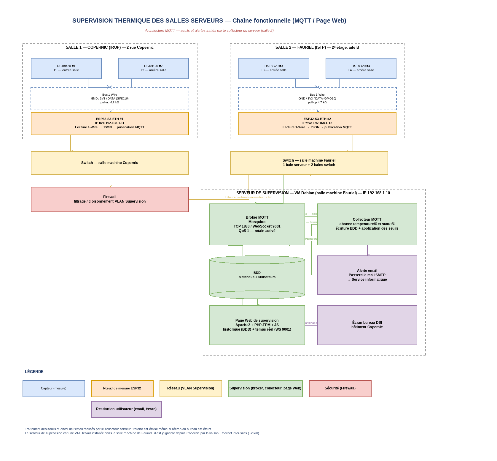
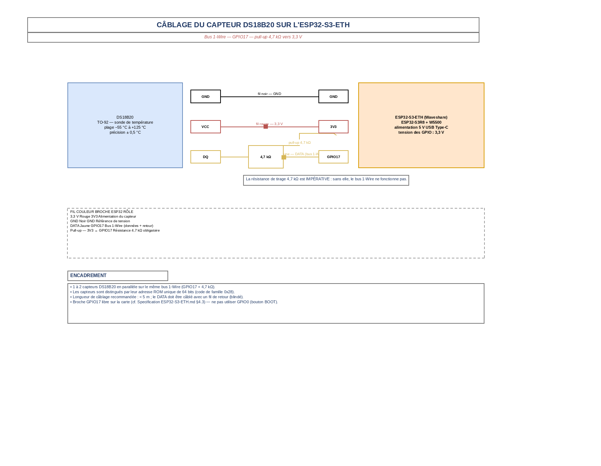
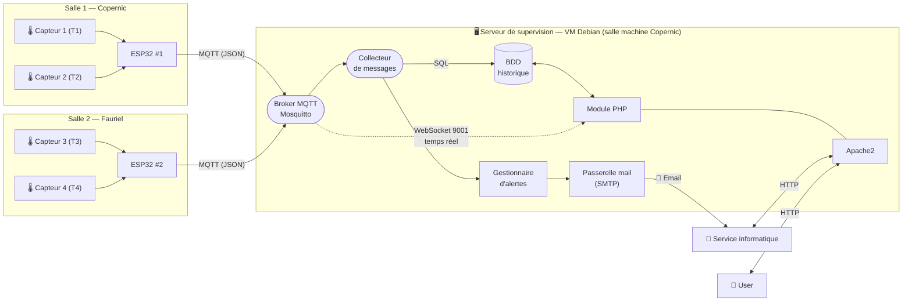
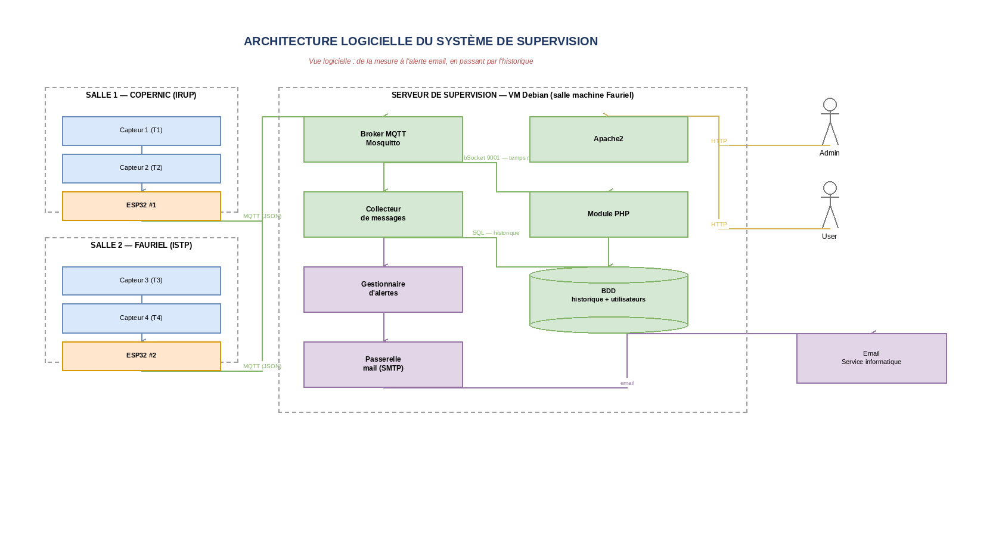
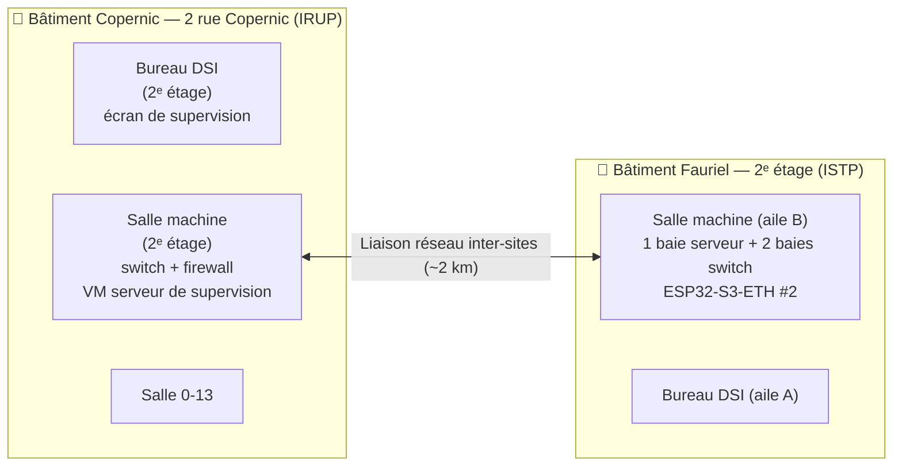
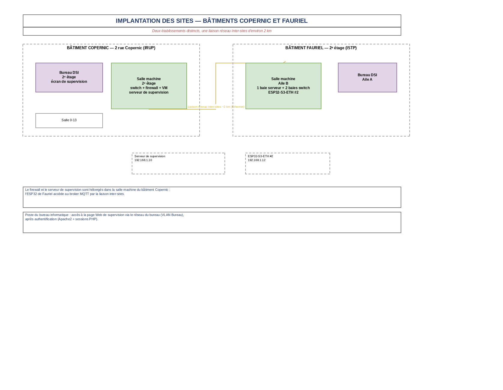
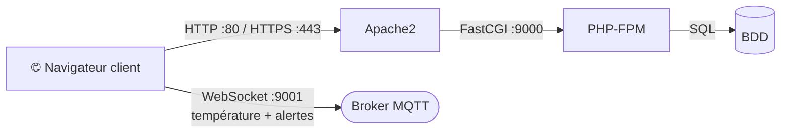
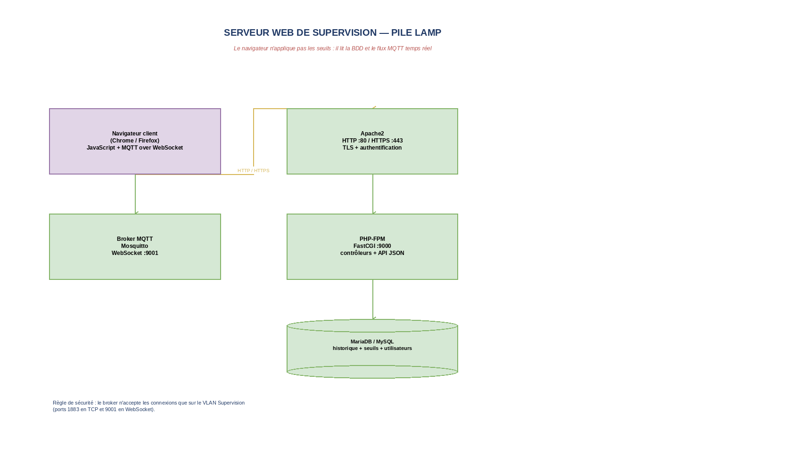
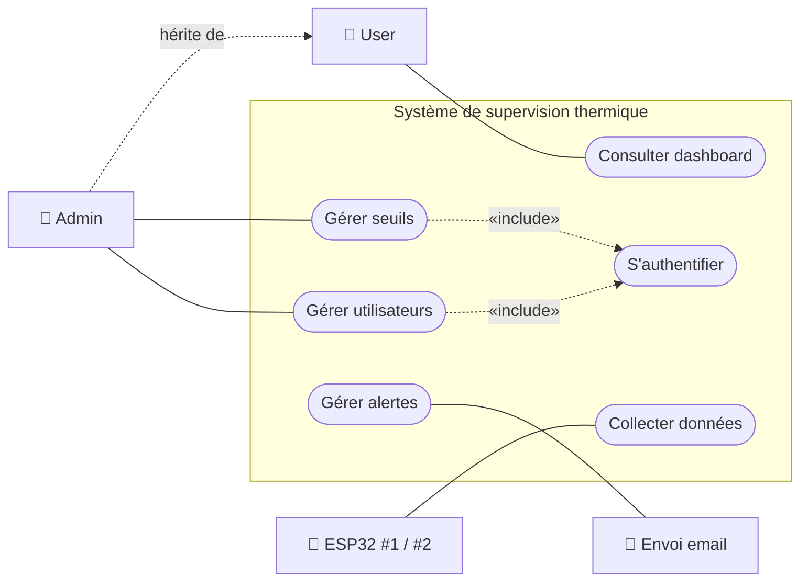
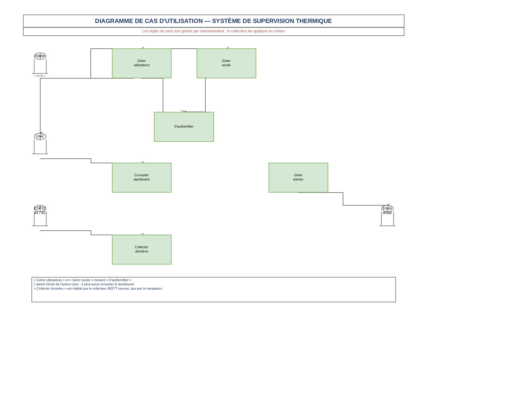

# Supervision thermique des salles serveurs — Cahier des charges

> **Structure de la présentation (5 points) :** Contexte → Besoin → Objectifs → Fonctions → Synoptique

| | |
|---|---|
| **Projet** | Supervision thermique des salles serveurs |
| **Porteurs** | Établissements IRUP (bâtiment Copernic) et ISTP (bâtiment Fauriel) |
| **Auteur** | Noah THEVENON — BTS CIEL 2025 |
| **Documents liés** | [Spécification ESP32-S3-ETH](./Specification%20ESP32-S3-ETH.md) · [Schémas Draw.io](./schemas/) |

---

## 1. Contexte

**Infrastructure de l'IRUP et de l'ISTP**

- Les établissements IRUP (bâtiment **Copernic**) et ISTP (bâtiment **Fauriel**) disposent chacun d'une **salle serveurs**, soit **2 salles serveurs** au total.
- Ces salles hébergent des **équipements critiques** : serveurs, équipements réseau, firewall.
- Une **panne de climatisation** peut provoquer une surchauffe des équipements informatiques et perturber les services.
- **Aucune supervision thermique automatisée** n'est en place.
- Extension prévue à la salle machine de BTS CIEL.

**Hors du ressort du service informatique :**

- La réparation ou le remplacement des climatisations.
- La modification des installations électriques ou des équipements existants.

---

## 2. Besoin

Surveiller en continu la température des salles serveurs et être alerté automatiquement en cas de dépassement, afin d'éviter tout risque de surchauffe du matériel informatique et de garantir la continuité de service.

---

## 3. Objectifs

- Surveiller la température des deux salles serveurs **en continu**.
- Alerter automatiquement en cas de température dépassant une plage autorisée.
- Afficher les températures sur un écran dans le bureau informatique.
- Rendre les données consultables sur une **page Web de supervision**.
- Conserver un **historique** des températures de chaque salle.
- Permettre la **gestion des utilisateurs** ( Administrateur et User ).

> Les seuils, la périodicité de mesure et la durée de conservation de l'historique sont les **critères de validation** du projet : ils sontulfillables et mesurables (§4.3, §5.7).

---

## 4. Fonctions

### 4.1 Fonctions attendues

Le système devra :

| N° | Fonction | Description |
|----|----------|-------------|
| F1 | **Mesurer** | Mesurer la température à au moins deux endroits dans chaque salle serveur (capteurs DS18B20). |
| F2 | **Acquérir et traiter** | Lire les capteurs sur un bus 1-Wire, mettre en forme les mesures en JSON et les publier sur le broker MQTT. |
| F3 | **Remonter** | Remonter les données en temps réel sur la page Web de supervision, par protocole **MQTT**. |
| F4 | **Historiser** | Enregistrer les mesures en base de données pour permettre la consultation et l'analyse des tendances. |
| F5 | **Alerter** | Gérer plusieurs types d'alertes selon les seuils de température (normal / avertissement / critique). |
| F6 | **Notifier** | Envoyer un **email** en cas de dépassement critique. |
| F7 | **Restituer** | Permettre un affichage permanent des températures dans le bureau informatique. |
| F8 | **Administrer** | Gérer les utilisateurs (**Administrateur** et **User**) et les paramètres de seuil. |

### 4.2 Périmètre

**Inclus dans le projet**

- Installation de capteurs de température dans les deux salles serveurs.
- Raccordement des capteurs au réseau et connexion à la page Web de supervision.
- Publication des mesures en **MQTT** vers le broker, abonnement par le collecteur et par la page Web.
- Enregistrement de l'historique des températures en base de données.
- Alerte par email en cas de température trop élevée.
- Affichage des températures sur un écran dans le bureau informatique.
- Authentification des utilisateurs et gestion des comptes.

**Non inclus dans le projet — évolutions prévues**

- Les autres locaux du bâtiment.
- Surveillance dans les baies de brassage (à venir).
- La supervision d'autres grandeurs (humidité, ouverture de porte, consommation électrique).

### 4.3 Exigences complémentaires

| Exigence | Choix retenu |
|----------|---------------|
| **Périodicité de mesure** | 1 mesure par capteur toutes les **1 minute** *(à valider)* |
| **Historique** | Conservation en base de données, **90 jours** *(à valider)* |
| **Utilisateurs** | 2 profils : **Administrateur** (gère comptes et seuils) et **User** (consultation seule) ; comptes stockés en base, mot de passe **haché** (bcrypt), session côté serveur (Apache2 + PHP) |
| **Destinataire de l'alerte** | Liste de distribution du **service informatique** (adresse à définir avec le service) |
| **Sécurité du broker** | Authentification par **identifiant / mot de passe** ; le broker n'accepte les connexions que sur le VLAN **Supervision** (ports 1883 et 9001) |
| **Sécurité du Web** | Page servie en **HTTPS** (certificat), accès réservé aux comptes autorisés |

---

## 5. Synoptique

> **Évolution de l'architecture :** la supervision n'est plus assurée par un serveur CheckMK et n'utilise plus le protocole SNMP. Elle est assurée par une **page Web de supervision dédiée**, alimentée par **MQTT** (broker Mosquitto), avec un traitement des seuils et l'envoi des alertes **réalisés côté serveur** (collecteur) : l'alerte est donc émise même si l'écran du bureau informatique est éteint.

Tous les schémas sont éditables dans [`schemas/`](./schemas/) (fichiers `.drawio`, à ouvrir avec [app.diagrams.net](https://app.diagrams.net) ou l'extension VS Code *Draw.io Integration*). Des **aperçus PNG** sont disponibles dans [`schemas/apercus/`](./schemas/apercus/).

### 5.1 Chaîne fonctionnelle

```text
   SALLE COPERNIC (IRUP)              SALLE FAURIEL (ISTP)
  ┌────────────────────────────┐    ┌────────────────────────────┐
  │DS18B20 #1  (T1)            │    │DS18B20 #3  (T3)            │
  │DS18B20 #2  (T2)            │    │DS18B20 #4  (T4)            │
  │                            │    │                            │
  │Bus 1-Wire  GPIO17          │    │Bus 1-Wire  GPIO17          │
  │GND / 3V3 / DATA            │    │GND / 3V3 / DATA            │
  │pull-up 4,7 kΩ              │    │pull-up 4,7 kΩ              │
  └────────────────────────────┘    └────────────────────────────┘
                 │                                 │
  ┌────────────────────────────┐    ┌────────────────────────────┐
  │ESP32-S3-ETH #1             │    │ESP32-S3-ETH #2             │
  │Ethernet W5500              │    │Ethernet W5500              │
  │IP fixe 192.168.1.11        │    │IP fixe 192.168.1.12        │
  │Client MQTT                 │    │Client MQTT                 │
  └────────────────────────────┘    └────────────────────────────┘
                 │  Ethernet 10/100 Mbps           │  (~2 km)
                 └───────────────┬─────────────────┘
                                 ▼
                  ┌──────────────────────────────┐
                  │Switch — VLAN Supervision     │
                  └──────────────────────────────┘
                                 │  Ethernet
                                 ▼
                  ┌──────────────────────────────┐
                  │Firewall                      │
                  │filtrage / cloisonnement VLAN │
                  └──────────────────────────────┘
                                 │  Ethernet
                                 ▼
   ┌──────────────────────────────────────────────────────────────┐
   │ SERVEUR DE SUPERVISION — VM Debian (salle machine Copernic)  │
   │                          IP 192.168.1.10                     │
   ├──────────────────────┬──────────────────────────────────────┤
   │ Broker MQTT          │ Collecteur MQTT                       │
   │ Mosquitto            │  • abonne temperature/# et statut/#   │
   │ TCP 1883 / WS 9001   │  • écrit l'historique en BDD          │
   │ QoS 1 — retain       │  • applique les règles de seuil       │
   ├──────────────────────┼──────────────────────────────────────┤
   │ Page Web (PHP + JS)  │ Base de données                       │
   │ temps réel (WS 9001) │ historique + utilisateurs + seuils    │
   ├──────────────────────┴──────────────────────────────────────┤
   │ Règles de seuil :  T < 27 °C : Normal                       │
   │                   27 ≤ T < 35 °C : Avertissement             │
   │                   T ≥ 35 °C : Critique                       │
   ├──────────────────────┬──────────────────────────────────────┤
   │ Alerte email         │ Écran bureau informatique             │
   │ Service informatique │ affichage permanent                   │
   └──────────────────────┴──────────────────────────────────────┘
                                 │
        PUBLISH   temperature/<salle>/<capteur>   (JSON)
        RETAIN    dernière valeur conservée par le broker
        LWT       statut/<équipement> = online / offline
```

📐 **Schéma draw.io — Chaîne fonctionnelle :** [`schemas/5.1-chaine-fonctionnelle.drawio`](./schemas/5.1-chaine-fonctionnelle.drawio)



### 5.2 Détail du nœud de mesure ESP32 (côté capteur)

Câblage du capteur DS18B20 sur une carte ESP32-S3-ETH :

```text
  DS18B20                     ESP32-S3-ETH
  ┌────────┐                  ┌──────────┐
  │  GND   ├──────────────────┤ GND      │
  │        │                  │          │
  │  VCC   ├──────┬───────────┤ 3V3      │
  │        │      │           │          │
  │  DQ    ├──────┴───────────┤ GPIO17   │  bus 1-Wire
  │        │   ┌───┴───┐      └──────────┘
  │        │   │▭▭▭▭▭▭│  4,7 kΩ
  │        │   └───┬───┘  (pull-up vers 3,3 V)
  │        │       │           ┌──────────┐
  │        │       └───────────┤ 3V3      │
  └────────┘                  └──────────┘
```

📐 **Schéma draw.io — Câblage DS18B20 :** [`schemas/5.2-cablage-ds18b20.drawio`](./schemas/5.2-cablage-ds18b20.drawio)



| Fil     | Couleur | Broche ESP32  | Rôle                           |
|---------|---------|---------------|--------------------------------|
| 3,3 V   | Rouge   | 3V3           | Alimentation du capteur        |
| GND     | Noir    | GND           | Référence de tension           |
| DATA    | Jaune   | GPIO17        | Bus 1-Wire (données + retour)  |
| Pull-up | —       | 3V3 → GPIO17  | Résistance 4,7 kΩ obligatoire  |

Le nœud de mesure ESP32-S3-ETH peut embarquer 1 à 2 capteurs DS18B20 en parallèle sur le même bus 1-Wire (GPIO17 + 4,7 kΩ) ; les capteurs sont alors distingués par leur adresse unique de 64 bits (code de famille `0x28`).

> **Pourquoi GPIO17 ?** La carte réserve GPIO17 pour le bus 1-Wire (broche libre et non mutualisée avec le W5500, la carte TF ou l'interface caméra) — cf. [Spécification ESP32-S3-ETH](./Specification%20ESP32-S3-ETH.md) §4.3.

### 5.3 Architecture logique du serveur de supervision



📐 **Schéma draw.io — Architecture logique :** [`schemas/5.3-architecture-logicielle.drawio`](./schemas/5.3-architecture-logicielle.drawio)



**Répartition des rôles — qui fait quoi ?**

| Acteur / composant | Rôle |
|--------------------|------|
| **ESP32-S3-ETH** | Mesure, met en forme le JSON, publie sur MQTT. Ne décide rien. |
| **Broker Mosquitto** | Réception, conservation (retain) et distribution des messages. |
| **Collecteur (serveur)** | Seul composant à **appliquer les règles de seuil** et à déclencher l'email. Écrit l'historique en BDD. |
| **Page Web** | Consultation : historique depuis la BDD, affichage temps réel par WebSocket. Elle **n'envoie aucun email** (pas de doublon d'alerte). |
| **Apache2 + PHP** | Authentification, gestion des comptes et des seuils, API JSON. |

Exemple de message publié par un ESP32 :

```json
{ "capteur": "t1", "salle": "copernic", "temperature": 25.4, "timestamp": "2026-10-20T14:32:00Z" }
```

> Le capteur DS18B20 ne mesure que la **température** : aucun champ d'humidité n'est publié.

### 5.4 Communication MQTT

| Élément               | Valeur                                          |
|-----------------------|-------------------------------------------------|
| Protocole applicatif  | MQTT 3.1.1 (TCP 1883)                           |
| Transport navigateur  | WebSocket (port 9001)                           |
| QoS                   | 1 (au moins une fois)                           |
| Retain                | Oui (dernière valeur conservée par le broker)   |
| Authentification      | Identifiant / mot de passe sur le broker        |
| Keep-alive            | 60 s, Last Will and Testament = online/offline  |

**Arborescence des topics :**

| Topic                      | Éditeur        | Abonné(s)                  | Contenu                       |
|----------------------------|----------------|----------------------------|-------------------------------|
| `temperature/copernic/t1`  | ESP32 #1       | Collecteur, Page Web       | Température T1 en °C (JSON)   |
| `temperature/copernic/t2`  | ESP32 #1       | Collecteur, Page Web       | Température T2 en °C (JSON)   |
| `temperature/fauriel/t3`   | ESP32 #2       | Collecteur, Page Web       | Température T3 en °C (JSON)   |
| `temperature/fauriel/t4`   | ESP32 #2       | Collecteur, Page Web       | Température T4 en °C (JSON)   |
| `alerte/temperature`       | Collecteur     | Page Web, journal d'alertes| Message d'alerte formaté      |
| `statut/<equipement>`      | ESP32 #1 / #2  | Collecteur, Page Web       | `online` / `offline`          |

- Le dernier point de mesure connu est conservé en mémoire par le broker grâce au drapeau **retain** : la page Web affiche une valeur même si un ESP32 est momentanément hors ligne.
- Chaque ESP32 publie `statut/<equipement> = online` à la connexion ; le **LWT** publie `offline` en cas de perte de connexion.

### 5.5 Légende / chaîne fonctionnelle

| Étape | Élément                              | Rôle                                                   |
|-------|--------------------------------------|--------------------------------------------------------|
| 1     | Capteurs DS18B20 (1 à 2 par salle)   | Mesure de la température                               |
| 2     | ESP32-S3-ETH (1 par salle)           | Lecture 1-Wire, mise en forme JSON, publication MQTT   |
| 3     | Switch — VLAN Supervision            | Transport des données Ethernet                         |
| 4     | Firewall                             | Filtrage et cloisonnement du VLAN Supervision          |
| 5     | Broker MQTT Mosquitto                | Réception, conservation (retain) et distribution       |
| 6     | Collecteur (serveur)                 | Application des seuils, écriture de l'historique       |
| 7     | Base de données                      | Historique des températures, comptes et seuils         |
| 8     | Page Web de supervision              | Affichage temps réel et historique, gestion des comptes |
| 9     | Notification email                   | Alerte au service informatique                         |
| 10    | Écran bureau informatique            | Affichage permanent                                    |

### 5.6 Adressage IP

| Équipement                                     | Adresse IP     | VLAN         |
|------------------------------------------------|----------------|--------------|
| ESP32-S3-ETH #1 (Copernic)                     | 192.168.1.11   | Supervision  |
| ESP32-S3-ETH #2 (Fauriel)                      | 192.168.1.12   | Supervision  |
| Serveur de supervision (Mosquitto + page Web)  | 192.168.1.10   | Supervision  |
| Poste du bureau informatique                   | Via DHCP       | Bureau       |

### 5.7 Seuils de température *(à valider)*

| Niveau        | Température          | Action                                                    |
|---------------|----------------------|-----------------------------------------------------------|
| Normal        | T < 27 °C            | Aucune                                                    |
| Avertissement | 27 °C ≤ T < 35 °C    | Alerte visuelle dans la page Web                          |
| Critique      | T ≥ 35 °C            | Alerte visuelle dans la page Web + email au service info  |

Les règles de seuil sont appliquées **par le collecteur**, à réception de chaque message publié sur les topics `temperature/...` ; les seuils sont modifiables par l'administrateur et stockés en base de données.

### 5.8 Implantation des sites



📐 **Schéma draw.io — Implantation des sites :** [`schemas/5.4-implantation-sites.drawio`](./schemas/5.4-implantation-sites.drawio)



> Le firewall et le serveur de supervision sont hébergés dans la salle machine du bâtiment Copernic : l'ESP32 de Fauriel accède au broker MQTT par la liaison inter-sites (~2 km).

### 5.9 Serveur Web



📐 **Schéma draw.io — Serveur Web :** [`schemas/5.5-serveur-web.drawio`](./schemas/5.5-serveur-web.drawio)



### 5.10 Diagramme de cas d'utilisation



📐 **Schéma draw.io — Cas d'utilisation :** [`schemas/5.6-cas-utilisation.drawio`](./schemas/5.6-cas-utilisation.drawio)



- « Gérer utilisateurs » et « Gérer seuils » **incluent** « S'authentifier ».
- L'admin **hérite** de l'acteur User : il peut aussi consulter le dashboard.
- « Collecter données » est réalisé par le **collecteur MQTT serveur**, et non par le navigateur.
